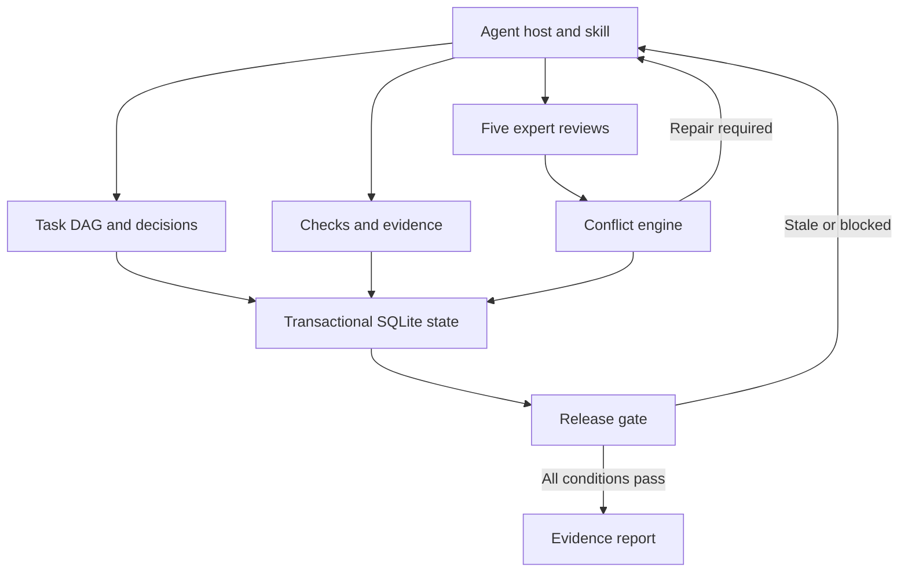

# Architecture and invariants

FORGE-5 separates a portable engineering procedure from deterministic local
coordination. The host agent owns reasoning, source edits, tool access and user
authorization. The runtime owns validated contracts, persistent workflow state,
freshness, subprocess lifecycle and release conditions.

## Runtime modules

| Module | Responsibility |
| --- | --- |
| `models` | Strict JSON contracts, role/severity enums and bounded input fields |
| `store` | Atomic snapshots, revisions, hash-linked event history and streamed verification |
| `workspace` | Source content/path/executable-bit fingerprints and unsupported-file rejection |
| `config` | Versioned TOML policy and validated executable check specifications |
| `engine` | Task DAG transitions, decisions, objections, dispositions and release invariants |
| `runner` | Trusted argv execution, deadlines, capped capture and POSIX group termination |
| `council` | Role packets, parallel reviewer dispatch, fail-closed rounds and bounded repair loops |
| `testing`, `security` | Nonempty unittest discovery and limited AST security triage |
| `report`, `cli` | Derived reports and JSON-first host interface |

## Storage and concurrency

One project has one `.forge5/council.sqlite3`. SQLite WAL mode, a busy timeout and
`BEGIN IMMEDIATE` serialize mutations. Each mutation updates a versioned JSON
snapshot and appends its audit event in the same transaction. Failed operations
roll back both. The expected revision rejects stale concurrent actions. Snapshot
metadata is capped at 16 MiB; large codebases should keep task contracts concise.
The runtime tracks engineering metadata, not every source file in the database.

An event binds its sequence, timestamp, action, payload, previous event hash and
resulting state digest. Verification streams events inside a consistent read
transaction. This supports corruption detection, not authenticated provenance or
event replay. The trusted host can rewrite the database and its hashes.

## Tasks and decisions

Tasks name an owner, acceptance contract and existing dependencies. Requiring
dependencies to exist before adding a task makes cycles impossible by construction.
Running/done transitions require completed dependencies. Reopening a prerequisite
requires resetting active/completed dependents first. Completion requires evidence
text; expert review must judge whether that text is substantiated.

Adding/updating tasks or recording decisions clears approvals. Reviews also bind
a context digest over goal, task contracts/state, decisions and that author's
finding/disposition history. An old host packet cannot restore approval after
the plan changes or renew an author's approval after a new objection/disposition.

## Review rounds and conflict lifecycle

A round first atomically revokes old approvals and records an active round ID.
Packets carry current source and context digests, task contracts, checks, open
findings and prior reviews. Up to five trusted review commands run concurrently.
Malformed responses, failures, timeouts and wrong-role responses become abstentions.
All five validated results commit atomically, guarded by source/context freshness
and expected revision. Per-role contexts permit parallel reviews while binding
each expert's own objection history. A concurrent mutation, source edit, interrupted process or
crashed host leaves the round incomplete and release blocked. Retry the round, or
use `forge5 round-cancel --reason ...`; cancellation keeps approvals revoked.

Each finding is namespaced by its role. A later clean review cannot erase an open
objection. Only the declared author can close it. Fixes require named current
passing check evidence. Rejections require a rationale. Accepted risk is permitted
only for low/medium findings. Closing a finding invalidates that author's approval;
recurrence reopens the stable finding and retains disposition history.

## Release conditions

The gate derives readiness from current state; no stored boolean can override it:

1. Audit chain and snapshot integrity pass.
2. No incomplete council round exists.
3. At least one implementation task exists and every task is done.
4. All five roles approve the current source and plan context.
5. No finding is open.
6. Every required configured check has passing evidence for current source and its
   resolved command/policy digest.

Evidence includes argv, exit code, duration, timeout/truncation flags, check digest
and source digest. A command that changes source fails its own check. A performance
check can require `max_seconds`. Generic checks trust the configured command's exit
contract; the default test command specifically rejects zero-test/all-skipped runs.

## Scale and extension points

The CLI and JSON packets fit hosts that cannot call Python directly. The SDK
accepts a `Reviewer` callable and optional `Repair` callback. Command adapters
support independent agent processes without a mandatory provider dependency.
External state machines, distributed queues, authenticated expert identities,
hosted model billing and remote sandbox provisioning are outside this release.

Large multi-module projects are decomposed into verifiable integration slices;
the runtime is not a promise of unlimited context or arbitrary autonomous success.
See the security model for snapshot exclusions and environment freshness limits.
