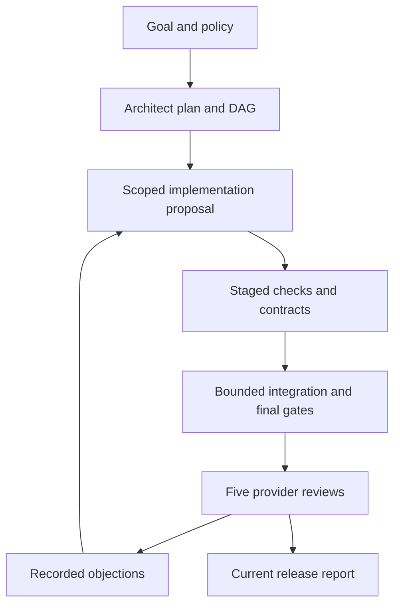

# Engineering platform validation

This report describes the expanded, unreleased engineering platform on Linux/Python 3.12.14. It is separate from the historical 0.1.0 report. Raw outputs are under [evidence/v2](evidence/v2); [source-manifest.json](evidence/v2/source-manifest.json) binds those results to SHA-256 hashes of every runtime module. A code change requires new results. Local evidence is not a signed attestation.

## Implemented architecture

The portable skill activates host behavior; the installed Python runtime persists and enforces the workflow. `AgentRegistry` requires six separately declared providers. Each invocation is a fresh process with a distinct role contract, model/provider metadata and audited isolation result. Provider credentials and reasoning are supplied externally.



Task state, decisions, constraints, findings, evidence, provider policy and resumable checkpoints live under `.forge5/`. Change sets contain exact owned paths, preimage hashes, proposed contents and inspectable patches. Existing acceptance tests and core policy are protected. Source, plan, role findings and execution/provider policies invalidate old approvals. Replanning replaces owned tasks, validates the combined DAG, and refuses to reset prerequisites beneath active external dependents.

## Actual verification

| Check | Observed result |
| --- | --- |
| Runtime unittest suite | 140 tests passed in 41.941 seconds |
| Runtime branch-inclusive coverage | 89.19%; unchanged required minimum 80% |
| Ruff lint / formatting | Pass, 35 formatted files checked |
| Strict mypy | Pass, 22 runtime modules |
| Bandit and source AST triage | Pass, no reported findings |
| Wheel and source distribution | Built successfully with isolated build dependencies |
| Official skill validator | `Skill is valid!` |
| DurableFlow behavior | 26 tests passed |
| DurableFlow workload | 200 jobs, four workers; see measured JSON, 10-second budget |
| Five-project paired evaluation | Baseline 5/5 and FORGE-5 5/5; zero regressions, 12 tests per arm |
| Required unavailable dependency audit | Correctly blocked: exit 1, `pip-audit` unavailable |

The original tests remain present. New tests cover planning and multi-task execution, staged integration, real objections and author-owned repair dispositions, failed-provider resume, stale policies, combined-DAG replanning, failed invocation reporting, role permissions, isolation protocol, architecture, memory, quality inventories and paired evaluation.

The multi-module DurableFlow example was rerun: SQLite persistence, fenced claims, retries, concurrent workers and crash recovery. Its 26 tests pass. The current development-cycle fixtures also create multi-file packages, preserve existing tests, add new tests, execute checks, obtain five provider responses, repair an objection and reach the release gate. These establish workflow behavior; a live model building an application of DurableFlow's complexity through the new orchestrator has not been demonstrated.

## Defects found during independent review

Each row records a real reproducible finding and its regression evidence. Reviewers requested changes before the repairs and rechecked them afterward. Review role labels remain local declarations, not authenticated attestations.

| Finding | Severity | Repair and evidence |
| --- | --- | --- |
| SEC-001: legacy local evidence claimed a registered isolation policy | High | Legacy checks reject policy-managed execution and transactional policy races; `test_legacy_check_cannot_claim_registered_isolation` plus independent interleaving probe |
| SEC-002: root host produced root container user | Medium | Nonzero fallback UID/GID; `test_container_fixture_enforces_flags_and_cleanup` |
| SEC-003: container provider received inaccessible host root | Medium | Provider root is relative to its actual project cwd; current development/provider tests |
| SEC-004: provider policy path alias bypass | Medium | Canonical scopes and changes; broker protection; `test_provider_configuration_cannot_be_replaced_through_alias` and development canonical-path regressions |
| SEC-005: overlapping paths left a partial patch | Medium | Ancestor collisions rejected before writes; `test_overlapping_changes_are_rejected_before_writing` |
| SEC-006: CRLF files failed valid preimage checks | Medium | Preserve exact newline bytes; `test_change_preimage_uses_exact_crlf_bytes` |
| ARC-001: valid package reexport reported a self-cycle | Medium | Implicit package base omitted; explicit self-import still fails; `test_package_reexports_do_not_form_implicit_self_cycles` |
| DAG-001: replacement plans stranded obsolete pending tasks | High | Replace prior owned tasks transactionally; real replacement-build regression |
| DAG-002: replanning could introduce retained/new cycles | High | Validate the complete final graph and external references before commit; cycle regressions |
| DAG-003: replanning reset prerequisites beneath completed external work | High | Reject active/completed transitive external dependents, preserve completion evidence |
| RUN-001: failed resumed build reported old readiness as current success | High | Report requires current ready phase; infrastructure-failure regression |

## Paired evaluation

See [the evaluation protocol](evaluation-v2.md) and current [raw paired report](evidence/v2/evaluation.json), with a [readable table](evidence/v2/evaluation.md). Five cases cover logic, concurrency, path security, SQLite migration and algorithmic work. Each arm executes 12 acceptance/regression tests across the five projects. Both arms use the same deterministic repair oracle: baseline direct implementation versus actual FORGE-5 planning, bounded integration, checks and five review calls. Both receive the same round budget; this is not equal token/cost usage.

Both arms pass all five cases with no new regression. FORGE-5 uses seven provider calls per case versus one for baseline. Additional orchestration costs time; the fixtures do not establish AI superiority. Actual elapsed times, test output, rounds and fingerprints are retained. Cost is unknown (`null`), and no live paid model experiment is claimed.

## Reproduce from a clean checkout

```bash
python3 -m venv .venv
. .venv/bin/activate
python -m pip install -e '.[dev]'
python -m coverage run -m unittest discover -s tests -v
python -m coverage report
python -m ruff format --check src tests scripts adapters
python -m ruff check src tests scripts adapters
python -m mypy
python -m bandit -r src/forge5 -c pyproject.toml
python -m forge5 scan src
python -m build
(cd examples/durableflow && python -m unittest discover -s tests -v && python bench.py)
forge5 evaluate --mode fixture --execute --allow-local --run-id my-verification
```

The official skill-creator `quick_validate.py` validator passes against `skills/forge-5`; its observed output is retained. The validator belongs to the host tooling and is not vendored or replaced with a fabricated validator. Installation and real provider setup are documented in [the platform guide](platform-v2.md).

## Remaining limits

- Independent AI model behavior and general engineering success have not been measured. Six declared providers and distinct processes are supported; fixture agents are deterministic and share an oracle.
- Docker/Podman are absent here. Container flags, image availability checks and cleanup are tested with executable protocol fixtures; no real container run or enforced local isolation is claimed.
- Evaluation currently requires explicitly permitted trusted local execution. Local providers inherit host privileges and can bypass the in-process broker. Audit coverage is limited to mediated operations and invocation metadata.
- `pip-audit` is not installed in this environment. The required-audit probe exits 1 with explicit `unavailable` evidence, rather than inventing a vulnerability-free result. Install the scanner and configure it as a required project gate when needed.
- SBOM/license inventory describes the current interpreter's installed distributions, not a resolved target lockfile. Secret patterns and AST security/import analysis are incomplete; dynamic dependencies need review.
- Coverage runs for the runtime; property-based and mutation checks can be configured as actual custom gates, but those tools and campaigns were not run in this validation.
- Durability is transactional for council state. External providers and side effects are not exactly-once after a host crash, patch application is not a cross-process filesystem transaction, and detached local processes are not fully contained.
- This is an alpha API, not a production or unbounded autonomous capability. Release reports readiness; they do not publish a package or deploy software.
